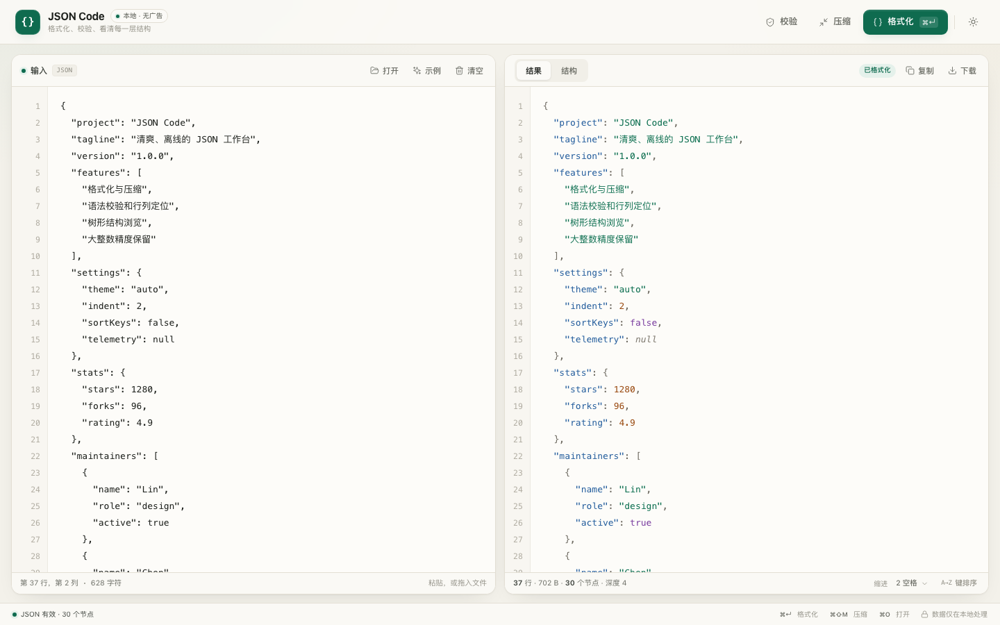

# JSON Code

一个清爽、无广告、完全本地运行的 JSON 格式化小工具。

没有注册、没有统计脚本、没有网络请求。双击 `index.html` 就能用，也可以丢到任意静态服务器上。



## 功能

- **格式化 / 压缩**：支持 2 空格、4 空格和 Tab 缩进，可一键压缩为一行。
- **精确校验**：自研严格 JSON 解析器，错误精确到行、列和字符位置，并给出中文修复提示。
- **大整数不丢失**：数字按原始文本保留，`900719925474099312345` 这种超过 JS 安全整数的值格式化后不会被改写。
- **重复键提醒**：保留所有重复键，同时提示重复位置，避免数据被静默覆盖。
- **树形浏览**：展开 / 折叠、搜索键和值、复制 JSONPath、大节点分页渲染。
- **键排序**：可按键名 A→Z 重排输出和结构视图。
- **结果操作**：复制、下载为 `.json`、格式化/压缩状态一目了然。
- **本地优先**：支持打开本地文件、拖拽导入、撤销清空；所有内容只停留在浏览器里。

## 打开方式

直接双击 `index.html` 即可，无需安装依赖。

如果想用本地服务器（推荐，行为更接近线上部署）：

```bash
cd json-code
python3 -m http.server 8080
# 打开 http://localhost:8080
```

也可以使用任意静态服务器，例如 `npx serve .`。

## 快捷键

| 快捷键 | 功能 |
| --- | --- |
| `⌘ + Enter` / `Ctrl + Enter` | 格式化 |
| `⌘ + Shift + M` / `Ctrl + Shift + M` | 压缩为一行 |
| `⌘ + O` / `Ctrl + O` | 打开本地文件 |
| `⌘ + S` / `Ctrl + S` | 下载当前结果 |
| `Tab` | 在输入区插入两个空格 |

## 关于解析

- 严格遵循 JSON 语法：不支持注释、单引号字符串、尾随逗号。
- 数字不使用 `Number()` 转换，因此超大整数、指数写法（如 `1e400`）都会原样保留。
- 重复键属于合法 JSON，工具不会替你丢弃任何一个；格式化结果中会保留全部重复键并给出提醒。
- 出现语法错误时不会生成残缺结果，而是显示错误上下文和定位按钮。

## 目录结构

```text
json-code/
├── index.html      # 页面结构
├── styles.css      # 界面与主题
├── json-core.js    # 解析、序列化、语法高亮（无 DOM 依赖）
├── app.js          # 交互、树视图、文件读写
├── favicon.svg
└── README.md
```

## 隐私

页面没有分析工具、远程字体或第三方脚本。输入内容不会上传到任何服务器；主题、缩进和分栏宽度等偏好只写入本地 `localStorage`，不会保存 JSON 内容。

## 浏览器

面向现代浏览器（Chrome、Edge、Safari、Firefox）。建议使用较新版本以获得 `backdrop-filter`、`dvh` 和剪贴板 API 的完整体验；不支持时也会有可用的降级路径。
